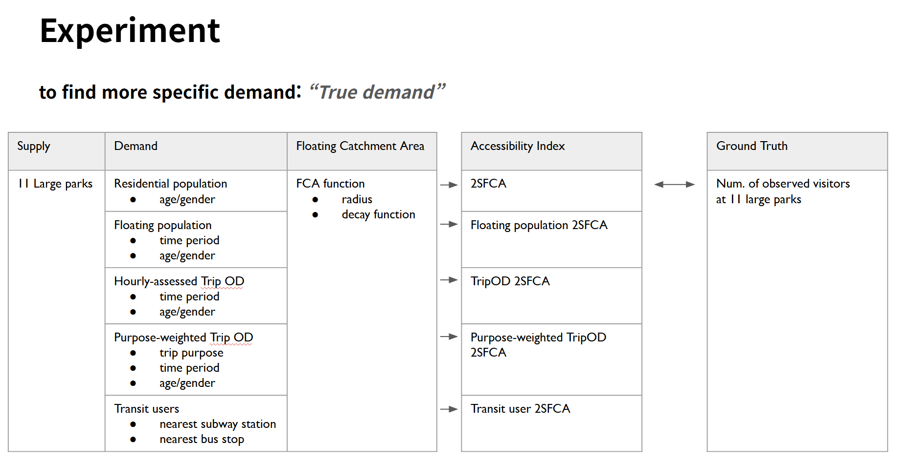
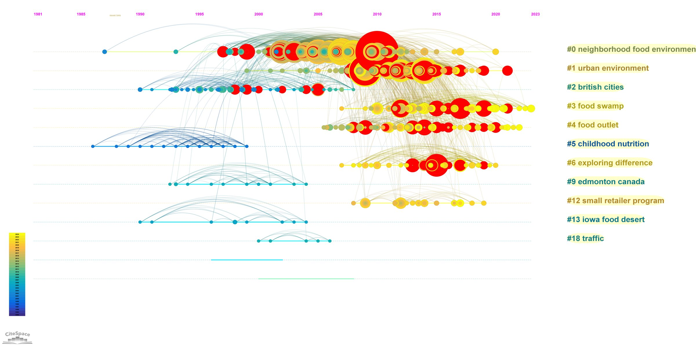

2022년 서울대학교에서 박사학위를 받은 뒤 KAIST 정보전자연구소에서 박사후 연구원 생활을 시작했다. 건축과 도시를 공부한 내가 전산학 연구실로 간 것은, ML/DL을 활용한 체계적인 연구 역량을 갖추고 싶기도 하던 차에 KAIST에 도시 문제에 관심을 가진 연구 그룹이 있다는 이야기를 듣고 그곳에 함께 만들자는 제안을 받았기 때문이다. KAIST의 도시 연구그룹은 소속 학과는 서로 달랐지만 공통의 연구 관심사를 탐색하고 있었다.

여러 차례 미팅과 연구 발표를 거치며, 관심사가 같다고 해서 함께 연구하기는 쉽지 않다고 느꼈다. 같은 도시 데이터를 앞에 두고도 각자 풀고자 하는 문제 정의와 연구에 대한 시각이 달랐다. 각자의 언어로 다르게 읽으면서도 함께 붙잡을 수 있는 문제가 필요했다.

과학사회학에는 이런 대상을 부르는 말이 있다. Star와 Griesemer가 제안한 'boundary object' 개념으로, 여러 분야에서 다르게 해석되면서도 서로 협업할 수 있게 해 주는 공통의 대상을 뜻한다[^1]. 이 개념은 나중에 알게 되었지만, 돌아보면 내가 찾던 것이 바로 그런 문제였다.

나는 접근성(accessibility) 문제가 바로 그런 boundary object이며, KAIST 도시 연구그룹이 다루어야 할 핵심 주제라고 제안했다. 수요와 공급이라는 시각에서 공원, 병원, 도서관 같은 생활 시설을 도시 내에서 어떻게 공급해야 사람들에게 적절한 수준의 공공 서비스를 제공할 수 있을지의 문제다. 도시계획에서는 오래된 형평성의 질문이지만, 수학과 산업공학의 언어로는 수요와 공급을 계산하고 시설의 입지를 최적화하는 문제가 되고, 데이터사이언스의 언어로는 실제 사람들의 이동 데이터로 그 계산이 맞는지 검증하는 문제가 된다. 예를 들어, 대표적인 지표인 2SFCA(two-step floating catchment area)는 거주 인구와 시설까지의 거리로 접근성을 계산한다. 하지만 발달한 교통망과 새로운 기술 때문에, 거주지로부터의 물리적 거리 외에도 접근성에 영향을 주는 맥락이 존재한다. 따라서 mobile signal 같은 실제 행태 데이터를 추가하는 등 2SFCA 지표를 개선하기 위한 여러 가지 전략을 꾀해 볼 수 있고, 이는 데이터 수집부터 처리, 시뮬레이션까지 다양한 데이터사이언스 문제와 결부시킬 수 있다.

{fig-alt="Supply(11개 대형 공원), Demand(거주인구, 생활인구, 시간대별 통행 OD, 목적 가중 통행 OD, 대중교통 이용자), Floating Catchment Area(반경, 거리 감쇠 함수), Accessibility Index(각 수요별 2SFCA), Ground Truth(공원 방문자 수)로 이어지는 실험 설계 표"}

Food Deserts 연구는 접근성 문제의 가장 대표적인 사례를 세계가 어떻게 논의해 왔는지 알고 싶어서 시작했다. 첫 미팅 날짜는 2024년 9월 25일이다. 전공이 서로 다른 연구자들이 저자로 모였고, 검색 전략과 분류 틀을 처음부터 정해 두고 시작한, 구조가 탄탄한 페이퍼였다.

선행연구 리뷰를 하며 보니 식품 사막에 대한 논의는 몇 차례 크게 바뀌어 왔다. 처음에는 슈퍼마켓까지 얼마나 먼가라는 '거리'의 문제였다. 이후 누가 접근하지 못하는가라는 '사람'의 문제로 옮겨 갔다. 최근에는 가까이에 있어도 건강한 음식을 고르기 어려운 food swamp, 가까이에 있어도 살 수 없는 food mirage, 그리고 온라인 배달 접근성까지 문화·환경적 '맥락'으로 논의가 넓어졌다. 같은 솔루션이 어디에서나 통하지 않는다는 것, 도시의 밀도나 지역 공동체 같은 장소의 조건이 정책의 효과를 좌우한다는 것이 이 리뷰의 결론이다. ([논문 링크](https://doi.org/10.1038/s42949-026-00458-2))

{fig-alt="CiteSpace로 그린 인용 네트워크 시계열 군집도. 1981년부터 2023년까지의 시간축 위에 neighborhood food environment, urban environment, british cities, food swamp, food outlet, childhood nutrition 등 11개 군집이 가로줄로 배치되어 있다"}

이 페이퍼를 함께 연구하고 투고하던 때에는 도시인공지능연구소가 아직 없었다. 이 협력 연구는 이후 도시인공지능연구소에서 여러 분야의 연구자가 함께 연구하는 방식을 이야기할 때 사례로 언급되곤 했다. KAIST 도시인공지능연구소는 2025년 설립된 이후 더 깊이 있는 연구들을 이어 가고 있다. 나는 연구소의 설립 준비부터 운영까지 직접 경험했다. AI, 데이터사이언스, 로보틱스, 경제학, 도시계획을 전공한 연구자들과 함께 연구했고, MIT, NYU, Stanford처럼 Urban Science라는 분야를 탐색하는 해외 대학들과의 협력에도 참여했다. 건축과 도시를 공부한 연구자로서 그 가운데에 있을 수 있었던 것에 감사한다.

[^1]: Star, S. L., & Griesemer, J. R. (1989). Institutional ecology, 'translations' and boundary objects: Amateurs and professionals in Berkeley's Museum of Vertebrate Zoology, 1907–39. *Social Studies of Science*, 19(3), 387–420.


