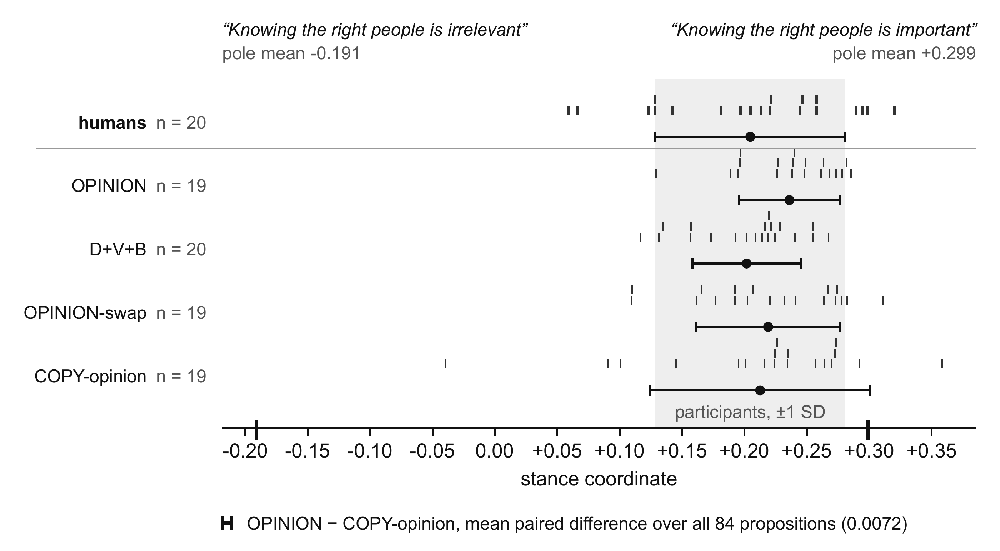

KAIST 창업원의 OverEdge 프로그램에 선발되어 심사받는 동안 가장 많이 받은 질문은 하나였다. 연구가 먼저인가, 고객이 먼저인가. 투자사 임원, 창업가, 멘토들이 표현을 달리해 같은 질문을 했다. 나는 매번 같은 답을 했다. 연구가 먼저인 학자가 나의 정체성이라고.

KAIST를 나온 것은 연구 책임자가 되기 위해서였다. 함께 일하고 싶은 좋은 연구자들이 있었지만, 이들과 함께 연구하려면 연구비를 지급할 수 있는 펀딩이 필요했다. 그 무렵 미국과 독일에서 갓 졸업한 박사들이 Frontier Lab을 창업하고 만드는 사례들을 보았다. 투자를 받아 연구 조직을 꾸리고 연구를 이어 가는 방식이었다. 연구소를 만드는 일이 학계가 아니라 산업계에서도 가능하다고 생각했다. 학자의 길을 접으려는 것이 아니라, 창업과 투자 사이클 안에서 연구 펀딩을 얻을 방법을 찾으려 했다.

연구하며 다듬던 아이디어가 KAIST 창업원과 연결되었다. 2026년 7월, 높은 경쟁률 속에서 AI 1인 창업 프로그램인 OverEdge의 100인에 선발되었고, 이후 여러 단계의 경쟁을 거쳐 최종 라운드까지 올랐다. 만들고자 한 연구소 스타트업의 이름은 Institute for Latent Publics다. 이름부터 연구소다. 드러나지 않은 공중, latent publics의 의견을 어떻게 묻고 확인할 수 있는지를 컴퓨터과학, 도시과학, 정치학 등 여러 분야의 연구자가 함께 연구하는 곳을 구상했다. KAIST에서 접근성이라는 공통의 문제로 서로 다른 분야의 연구자들과 일했던 경험이 이 구상의 바탕이 되었다. 투자자들에게 보여 준 자료의 첫 장에는 다음의 질문이 적혀있었다. 사람들의 의견은 계획과 결정에 어떻게 반영되는가.

사람들의 의견을 듣는 일이 얼마나 어려운지는 도시계획과 공공 부문에서 직접 겪었다. 석사시절 주민들의 실제 생활을 파악하기 위해 무척 노력했었다. 실무에서도 주민공청회에는 소수의 사람만 참여하고, 리서치를 맡기면 수백만원이 소모되고 대부분은 응답하지 않았다. 사람들의 의견을 듣고 싶은 것은 건축/도시 뿐만 아니라 마케팅, 언론, 정치, 관광, 상업 등 다른 분야에서도 절실한 문제였다. 프로그램 기간에 합성인구로 가상의 설문을 하는 Million Answers와 가상의 좌담회를 하는 Persona Roundtable을 직접 개발하여 배포했고, 다른 회사들의 요청으로 내가 만든 합성인구가 다른 서비스에도 들어가 쓰이고 있다.

서비스를 만드는 동안 합성 응답의 한계도 측정했다. 실제 사람들의 토론 데이터와 합성 응답을 비교한 결과, 합성 응답의 평균은 실제 참가자들의 범위 안에 들어왔지만 같은 사람끼리 비교하면 차이가 컸다. 가치관과 생애사 정보를 더해도 개인 수준의 차이는 줄지 않았다. 집단 수준에서는 맞지만 개인 수준에서는 맞지 않는다는 것이다. 이 결과를 논문으로 정리해 투고했고, 서비스의 사용 조건도 이 결과에 맞춰 정했다. 한 사람의 답이 아니라 집단의 반응 분포를 볼 것, 실제로 묻기 어려운 상황에서 쓸 것, 실제 반응을 다시 받아 비교할 수 있는 곳에서 쓸 것.

{fig-alt="stance coordinate 축 위에 humans, OPINION, D+V+B, OPINION-swap, COPY-opinion 다섯 조건의 의견 좌표 분포와 평균, 표준편차를 표시한 그림. 회색 띠는 실제 참가자의 평균 ±1 SD 범위"}

프로그램을 거치며 만난 분들 중 한 분의 말이 기억에 남는다. 연구 중심의 문화를 가진 스타트업을 좋아하지만, 한국에서 연구소 형태의 스타트업을 만들기는 쉽지 않다는 것도 안다고 했다. 하지만 박영준 박사는 처음 만났을 때부터 지금까지 연구소를 만들겠다는 말이 바뀐 적이 없고, 그것을 실현할 역량과 전략도 이미 갖고 있으니 절대 꺾이지 말라고 당부했다.

OverEdge 프로그램은 2026년 10월에 끝났다. 지금은 그동안의 경험과 생각을 정리하며 다음 단계를 준비하고 있다. 연구소를 만들고자 하는 생각은 그대로이고, 머지 않은 미래에 다음 단계를 공개할 수 있을 것이라 기대한다.


